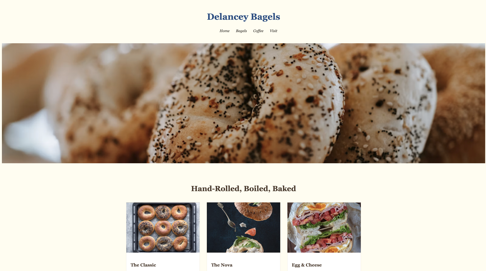

# Delancey Bagels 🥯

A one-page website for a New York bagel shop, with a menu, a coffee section, and the shop's hours and address.

## Description

This is a project I built to practice building a full web page with HTML and CSS only. It's a landing page for a made-up bagel shop called Delancey Bagels. It has a header with a menu, a big photo of bagels, three menu cards, a short section about coffee, and a footer with the address, phone number, and hours. The shop's details are sample content for practice. There is no JavaScript and no server to run.

## Screenshot

## Features

- Centered header with the shop name and a menu: Home, Bagels, Coffee, and Visit
- Full-width photo of everything and sesame bagels
- Three menu cards with a photo, a description, and a price: The Classic, The Nova, and Egg & Cheese
- A "Coffee, Regular" section
- A footer with the address, phone number, and hours
- Works on phones: the photo gets shorter, the menu cards stack in one column, and the menu links stack on very small screens
- Warm cream background with blue and brown text

## Tech Used

- HTML
- CSS (flexbox and media queries)

## How to Use

This site doesn't need a server or an API key.

1. Download or clone the project.
2. Open `index.html` in your browser (or use the Live Server extension in VS Code).
3. Scroll through the page. Shrink the window to see how it changes on a phone.

**Please note:** the menu links at the top don't go anywhere yet.

## How It Works

1. `index.html` is organized with a `header`, a `main` that holds the photo and the sections, and a `footer`.
2. The three menu cards are `section` elements that sit side by side with flexbox.
3. `style.css` sets the fonts, colors, and spacing. It makes the big photo fill the width and crop neatly with `object-fit: cover`.
4. Media queries change the layout on smaller screens. At 768px wide and under, the menu cards stack, and at 365px the menu links stack too.

## What I Learned

- How to structure a page with `header`, `main`, `section`, and `footer`
- How to lay out a row of cards with flexbox
- How to use media queries to make a page work on phones
- How to write helpful `alt` text for each photo
- How to choose a color palette and fonts that fit a food brand

## Author

Maya Rose 🌹
